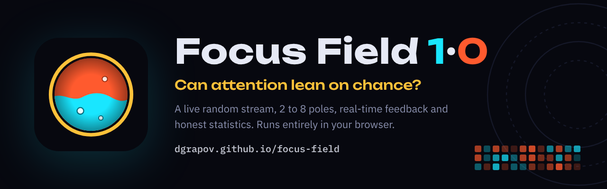
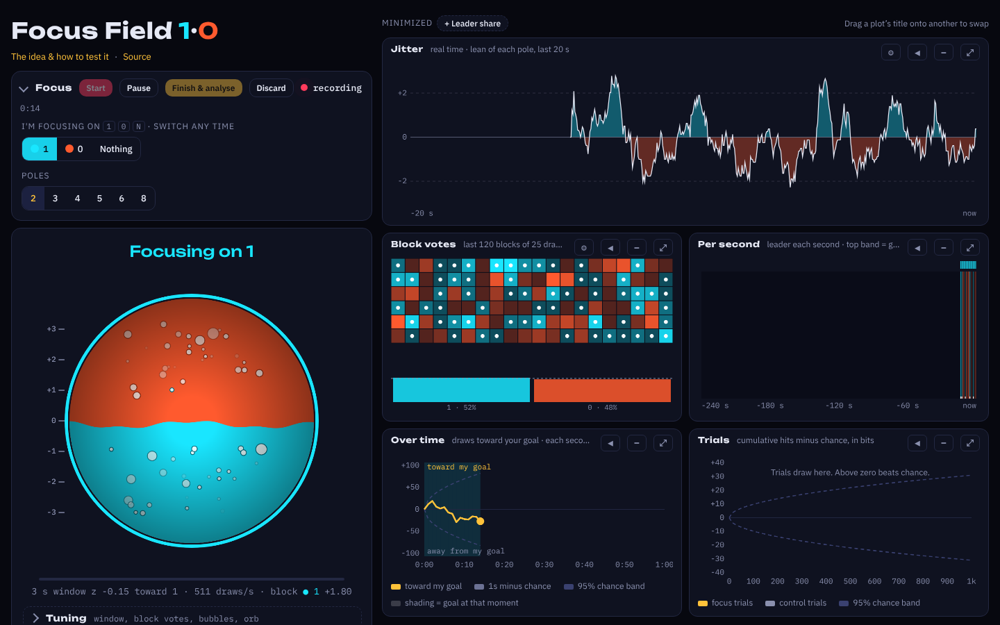
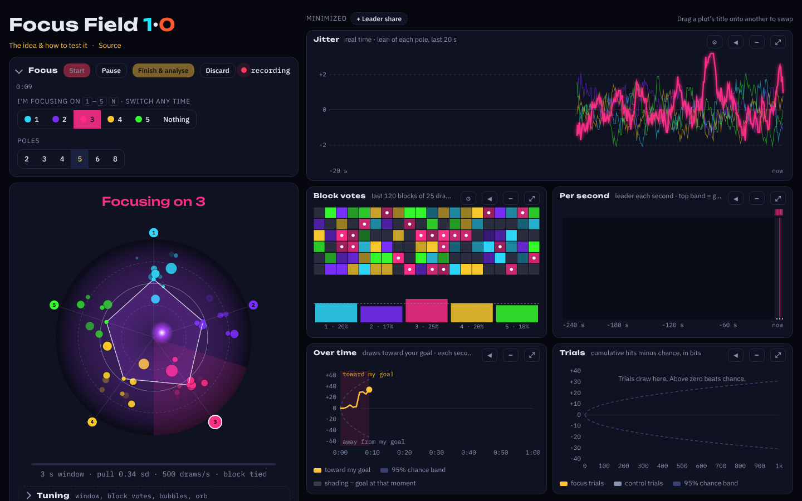

<p align="center">
  <a href="https://dgrapov.github.io/focus-field/"></a>
</p>

<p align="center">
  <a href="https://dgrapov.github.io/focus-field/"><b>Open the tool</b></a>
  &nbsp;·&nbsp;
  <a href="https://dgrapov.github.io/focus-field/about.html"><b>The idea &amp; how to test it</b></a>
</p>

<p align="center">
  <a href="https://dgrapov.github.io/focus-field/"></a>
  
  
  
  <a href="LICENSE"></a>
</p>

---

**Focus Field** runs a live random stream, 500 draws a second, split between 2 and 8 poles. Pick a pole, hold it in mind, and watch whether the stream leans your way, measured against exactly what chance predicts.

It tests an old, unproven idea: that the attention of a conscious observer can nudge randomness. Nothing in the tool assumes the effect is real. It is built so that a real effect could show up, and so that chance looks like chance.

<p align="center">
  
</p>

## What you see

<table>
  <tr>
    <td width="56" valign="top"></td>
    <td><b>The field.</b> A circle at 2 poles fills toward cyan or coral with the last few seconds' z-score. At 3–8 poles it becomes a radar with an orb pulled toward whichever poles the stream favours.</td>
  </tr>
  <tr>
    <td valign="top"></td>
    <td><b>Block votes.</b> Every block of draws (10 to 500, your choice) is one vote for the pole that won it. Winning blocks become real bubbles sized by their margin, and a grid shows recent votes with a white dot wherever your goal won.</td>
  </tr>
  <tr>
    <td valign="top"></td>
    <td><b>Jitter.</b> The lean of each pole drawn continuously over the last 10–60 seconds, with adjustable smoothing and height.</td>
  </tr>
  <tr>
    <td valign="top"></td>
    <td><b>Over time.</b> Every second counts toward the goal you held at that moment, plotted against a 95% chance band, so switching goals mid-session is fine.</td>
  </tr>
  <tr>
    <td valign="top"></td>
    <td><b>Trials.</b> Timed runs with a target chosen at random, fixed, or a no-focus control, with live or hidden feedback.</td>
  </tr>
  <tr>
    <td valign="top"></td>
    <td><b>Analysis and seeds.</b> Finishing a session reports goal z and p, a chi-square check of the no-focus seconds, leader changes and streaks against chance, and block votes for your goal. It also hashes the session into a SHA-256 seed you can reuse elsewhere.</td>
  </tr>
  <tr>
    <td valign="top"></td>
    <td><b>Private by design.</b> Everything runs in your browser. Nothing is sent to a server; sessions, history and settings live in your browser's local storage.</td>
  </tr>
</table>

The layout is yours to arrange: controls fold away, plots can be minimized to a dock, swapped by dragging, or expanded full screen.

<p align="center">
  
</p>

## The idea, briefly

From 1979 to 2007 the Princeton Engineering Anomalies Research lab reported that people could shift electronic random generators by a few parts in 10,000. A three-lab replication in 2000 did not confirm it, and a 2006 meta-analysis of 380 studies found a tiny effect that publication bias could explain. The question has never been settled to everyone's satisfaction.

At the size PEAR reported, an effect would need around 30 hours of recording to stand out, so single sessions will almost always look like noise. The [About page](https://dgrapov.github.io/focus-field/about.html) covers the history, what "observer" does and doesn't mean in physics, and a seven-step protocol for testing it without fooling yourself.

## How the randomness works

- Every draw comes from `crypto.getRandomValues`, the browser's cryptographic generator, seeded from your computer's hardware entropy.
- Bytes are fetched 16 at a time as they are needed, so each outcome is made a few hundredths of a second before it is shown, never stored up in advance.
- With more than 2 poles, bytes above the largest multiple of the pole count are rejected, so every pole is exactly equally likely.
- This is a fair, unpredictable stream, but not a physical noise source like the diode-based generators used in the original studies. Support for a USB hardware generator is planned.

## Run it yourself

There is no build step. The site is two static HTML files.

```bash
git clone https://github.com/dgrapov/focus-field.git
cd focus-field
python3 -m http.server 8000   # then open http://localhost:8000
```

Opening `index.html` directly in a browser also works.

## Roadmap

- Hardware random source through Web Serial (TrueRNG, OneRNG), with each session recording which source it used
- Download and load session reports and history as files
- Screen wake lock while recording

## License

[MIT](LICENSE) © Dmitry Grapov
